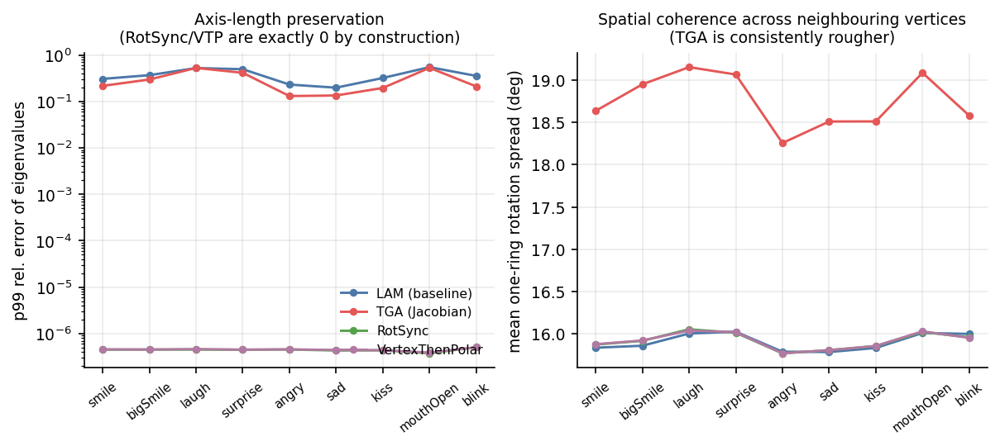
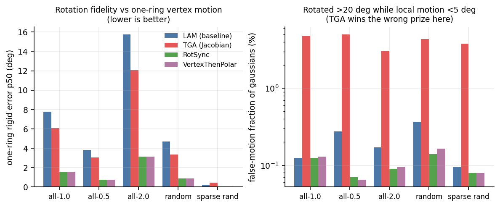
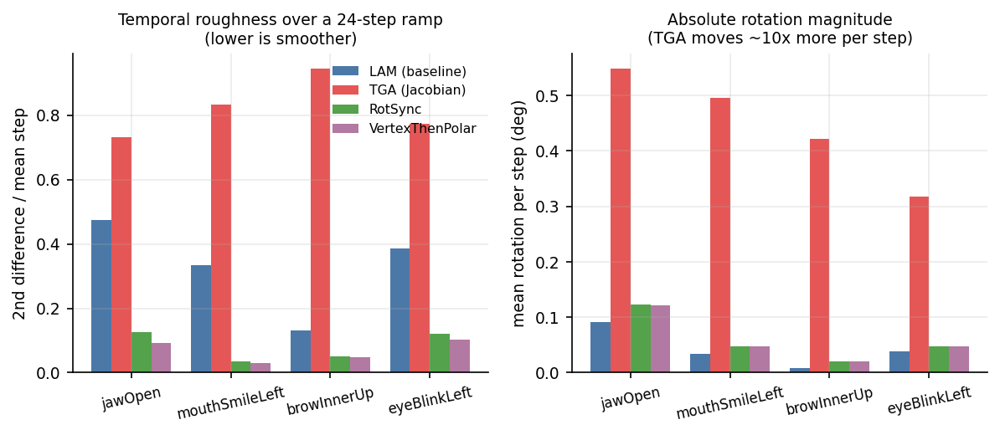
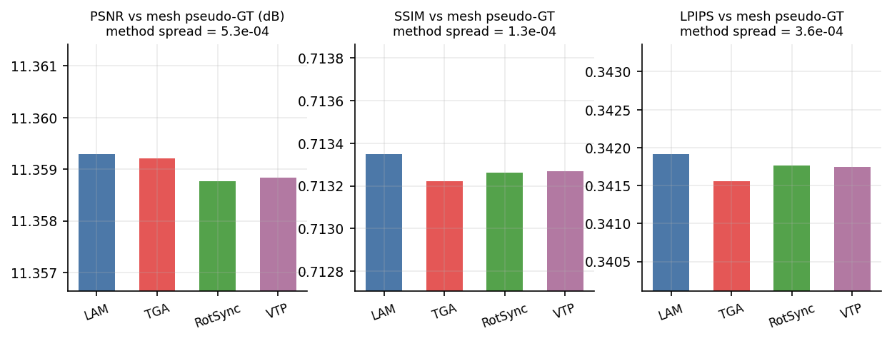
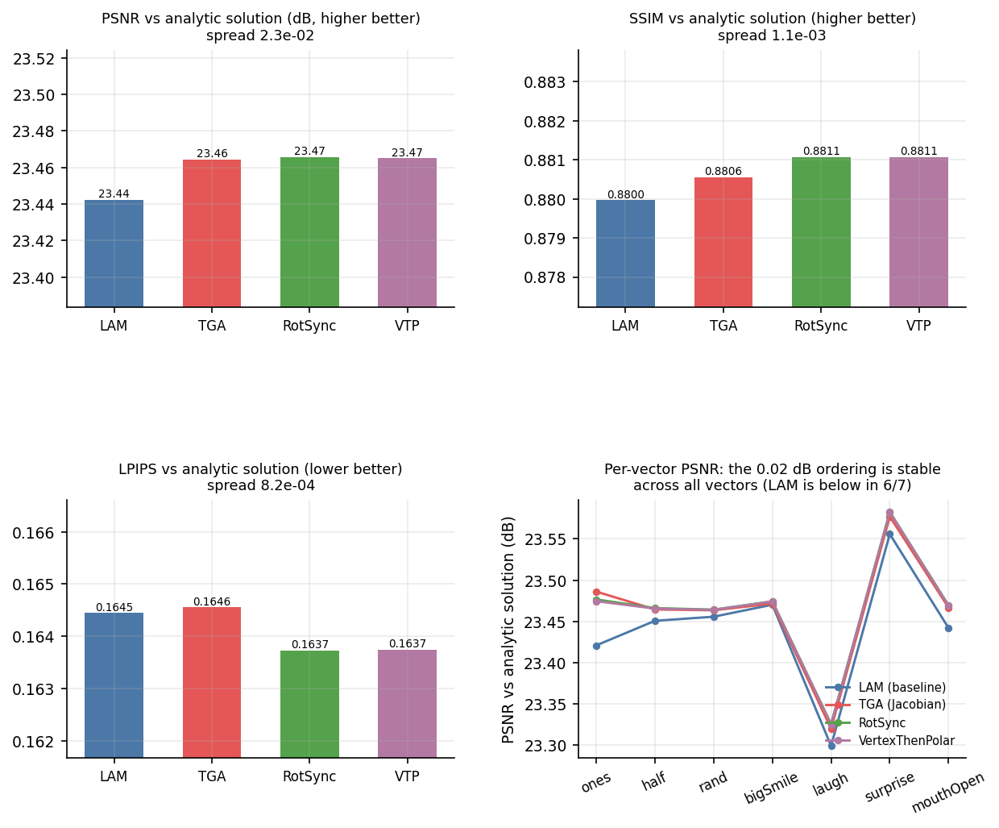

# 四种协方差调制方法的量化评测与方法细节

> 对象：`/workspace/lam3d` 中可切换的四种「表情驱动时如何更新高斯协方差」的实现。
> 数据来源：本文所有数字都来自已落盘的 JSON，可逐项复现（见 §8）。
> 配套文档：方法级源码逐行解读见 `docs/cov_methods_deepdive.md`；方法一的方案与消融见 `docs/rot_sync_plan.md`；为什么拿不到照片级真值见 `docs/gt_protocol_feasibility.md`。

---

## 0. 结论速览

**一句话**：在没有照片级真值的前提下，PSNR/SSIM/LPIPS 无法给四种方法排出「谁更真实」，但它们在**解析解参考系**下能给出稳定的微小排序，而真正有区分度的是四族补充指标 —— 保轴长、旋转保真度、空间一致性、时域平滑度。

| 维度 | 最优 | 最差 | 关键数字 |
|---|---|---|---|
| 耗时（render_full 端到端） | LAM 8.44 ms | RotSync 12.22 ms | 四者全部 < 30 ms 契约线；相对中性旁路增量 4.0 / 6.35 / 7.78 / 7.83 ms |
| 保轴长（eig_rel_err_p99） | RotSync / VTP 4.5e-07 | LAM 3.7e-01、TGA 2.95e-01 | RotSync 处在 float32 地板，LAM/TGA 在强表情下改变轴长 30%~82% |
| 旋转保真度（rigid_err p50，ones 向量） | RotSync 1.54 度 | LAM 7.76 度 / TGA 6.09 度 | RotSync 是 LAM 的 1/5、TGA 的 1/4 |
| 假旋转（false_move_frac） | RotSync 0.07%~0.14% | TGA 3.1%~5.0% | TGA 是其余三者的 20~60 倍 |
| 空间一致性（ring_jitter） | RotSync / VTP 15.92 度 | TGA 18.75 度 | TGA 系统性最差（9 个 preset 全部） |
| 时域平滑（rot_roughness） | VTP 0.029~0.093 | TGA 0.73~0.94 | RotSync/VTP 比 LAM 平滑 3.7~11.5 倍，TGA 比 LAM 差 1.6~7.2 倍 |
| 各向异性保持（aniso p50） | LAM / RotSync / VTP 4.140 | TGA 4.199（最大 4.533） | TGA 会放大各向异性 |
| 形状贴合（shape_err p50） | LAM 0.830 | RotSync 0.857 | 方法一按定义丢弃 shear，这是它的已知代价 |
| 像素 vs 解析解（PSNR/SSIM/LPIPS） | RotSync 23.466 / 0.88107 / 0.16373 | LAM 23.442 / 0.87997 / 0.16445 | 跨度仅 0.024 dB / 0.0011 / 0.0007，但排序在 7 个向量上稳定 |

**四句话**

1. **LAM 原版是「最省最快」的基线**：8.44 ms，但它在几何上只做面内 2x2 极分解 + 各向同性面积缩放，既不管面外旋转，也会改变轴长（p99 误差 37%）；假旋转率 0.12%~0.37%。
2. **TGA 是「最物理但最躁」的**：Σ' = J Σ₀ Jᵀ 是 GaussianAvatars / SurFhead 的线性化解，但它把 2/3 的高斯的解析解推出契约 1.35 上限（12% 超 10 倍），只能 clamp；结果是最会转（applied_deg 均值 18.5 度 vs LAM 7.9 度）、假旋转率 3%~5%、一环抖动最大、时域最糙。
3. **RotSync（方法一）是「最稳」的**：严格保轴长（eig 误差在 float32 地板）、旋转保真度最好、假旋转最低、时域最平滑，代价是丢掉 shear/stretch（shape_err 0.857 略差于 LAM 的 0.830）以及 12.22 ms 的耗时。
4. **VTP（先平均再分解）在绝大多数指标上与 RotSync 打平**，只在极端向量上略差（rigid_err p99 与最大角）：这符合理论预期 —— 两者只在「一环内面旋转方向相矛盾」时才分道扬镳，而这种顶点只占 0.2%~0.4%。**它的价值是作为「逐面极分解是否必要」的对照组**，不推荐上线。

---

## 1. 评测设定

### 1.1 为什么没有绝对真值

四方法作用在**同一张单图重建**上：输入一张照片 → 3DGS 资产 → 施加 ARKit 表情系数 → 渲染。这条链上不存在「同一身份、同一表情、同一相机」的第二张照片，因此：

- 没有真实照片 GT（`docs/gt_protocol_feasibility.md` 已逐条排除三条获取路径：`sample_input` 11 张全不同人、`uploads` 去重仅 16 张、`jobs` 94 个 `input.png` 去重仅 10 张；`sample_motion/export` 的 12 条序列只有 FLAME 参数没有图像，且都是他人身份）；
- 用 FLAME 网格渲染当 GT 时，网格与「高斯壳层」本身就有 ~11 dB 的系统差（高斯是围绕网格表面内外偏移的壳层，`|gs - tmpl|` 均值 0.0194）；
- 因此本报告不把 PSNR/SSIM/LPIPS 当作「质量」来排名，而是当作**到某个参考系的距离**来排名，并且显式标出每个参考系测的是什么。

### 1.2 五个参考系

| 编号 | 参考系 | 测的是什么 | 能否排序 | 结论 |
|---|---|---|---|---|
| A | 网格伪 GT（同 ARKit 偏移场形变的 FLAME 细分网格 + 顶点色，与 3DGS 同一相机/投影） | 与「理想薄壳几何」的像素一致性 | 名义上能，实际上不能 | 方法间跨度仅 5.3e-04 dB，作废（§2.1） |
| B | 以 LAM 为锚 | 相对基线的**改动量**，不是质量 | 不能 | 只用于说明「改了多少」（§2.2） |
| C | **解析解 Σ_exact = J_v Σ₀ J_vᵀ** | 到 GaussianAvatars/SurFhead 线性化解的距离 | 能，但跨度小 | 本报告主像素指标（§2.3） |
| D | 四方法两两一致度 | 谁最「居中」 | 能 | RotSync/VTP 最居中，LAM 最不合群（§2.4） |
| E | 几何 / 动力学指标 | 保轴长、旋转保真、假旋转、空间一致、时域平滑 | 能，且区分度最大 | 主表（§3） |

参考系 C 的关键性质：`Σ_exact` 是**形变模型的解析解**，不属于四种实现中的任何一种，因此不是「跟自己的实现比」。它的渲染方式是把 Σ 经 `eigh` 精确回写成 `(q, s)` —— 这是唯一被冻结渲染器读取的通道（`gs_renderer.py:534` 的 `cov3D_precomp = None` 是硬编码）。脚本里用 `max_scale_ratio=1e6, min_scale_ratio=1e-6` 关掉了 clamp，所以它就是**未被裁剪的解析解**。

### 1.3 口径与硬件

- GPU：RTX 4090 24 GB；Python 3.10.21；torch 2.3.0+cu121。
- 计时口径：`render_full()` 端到端（`animate_gs_model` + `orbit_c2w` + 512×512 光栅化），WARM=4、REP=15，取 median 与 p90。**这比契约里的 `compute_splat` 口径大**（后者不含光栅化），所以下表的数字是「上界」。
- 图像：512×512，正面视角（yaw=0），背景与推理时一致。
- 资产：`/workspace/LAM/assets/sample_input/messi.png` 单图重建，20018 个高斯（清理孤立顶点后网格侧 19494 顶点）。
- 随机种子固定 `np.random.default_rng(20261022)`。

---

## 2. 主表：PSNR / SSIM / LPIPS

三个指标的方向：PSNR ↑、SSIM ↑、LPIPS ↓。三张表分别对应三个参考系，**不能横向合并**。

### 2.1 参考系 A：网格伪 GT —— 不可排序（附定量证明）

9 个 ARKit preset × 正面视角的平均：

| 方法 | PSNR ↑ | SSIM ↑ | LPIPS ↓ |
|---|---|---|---|
| LAM 原版 | 11.3593 | 0.71335 | 0.34192 |
| TGA 雅可比 | 11.3592 | 0.71322 | 0.34155 |
| RotSync | 11.3588 | 0.71326 | 0.34176 |
| 先平均再分解 | 11.3588 | 0.71327 | 0.34174 |
| **方法间跨度** | **5.3e-04 dB** | **1.3e-04** | **3.6e-04** |

跨度比小数第三位还小，而且排序与参考系 C 矛盾（这里 LAM 的 PSNR 最高，是因为它改得最少、离「不动的图像」最近，而不是因为它更接近网格）。

**为什么**：把总平方误差拆成两部分（`scripts/eval_cov_variance_decomp.py`）——

- `E_sys`：四方法**共同**错的部分（方法均值图 vs 网格伪 GT），13 向量平均 **4761.60**；
- `E_var`：方法之间的分歧，13 向量平均 **0.478**；
- 比值 `E_var / E_sys = 1.00e-04`，即**方法间可区分的信息只占总误差的 0.01%**；
- 逐向量最有利于区分的是 ones（3.61e-04）与 mouthOpen（1.99e-04），最不利的是 blink（2.16e-05）与 smile（2.54e-05）。

结论：**这张表只应作为「四方法都与几何大致对得上」的体检，不得用于排序。**

### 2.2 参考系 B：以 LAM 为锚 —— 只有「改动量」

9 个 preset 平均（LAM 自己与自己比，`99.00 dB / LPIPS 0` 是定义上的恒等，不是成绩，不要写进任何排名）：

| 方法 | PSNR vs LAM ↑ | SSIM vs LAM ↑ | LPIPS vs LAM ↓ | 改动像素占比 |
|---|---|---|---|---|
| LAM 原版 | 99.00（恒等） | 1.00000 | 0.00000 | 0.00% |
| TGA 雅可比 | 48.59 | 0.99717 | 0.00262 | 12.39% |
| RotSync | 47.56 | 0.99713 | 0.00253 | 13.57% |
| 先平均再分解 | 47.60 | 0.99715 | 0.00250 | 13.57% |

单向量极值：全 1 向量改动 25%~27%（最强），`blink` 仅 4.2%~4.9%（最弱，因为闭眼时局部形变小）。

**读法**：RotSync 与 TGA 的改动量同量级（12%~14%），说明「只转向不拉伸」并没有让方法一的贡献变小 —— 它只是把改动全部放进了旋转自由度。

### 2.3 参考系 C：解析解 Σ_exact —— 本报告的主像素指标

7 个向量的平均（距离到 `Σ_exact = J_v Σ₀ J_vᵀ`，越小越好）：

| 方法 | PSNR ↑ | SSIM ↑ | LPIPS ↓ |
|---|---|---|---|
| LAM 原版 | 23.442 | 0.87997 | 0.16445 |
| TGA 雅可比 | 23.464 | 0.88055 | 0.16455 |
| **RotSync** | **23.466** | **0.88107** | **0.16373** |
| 先平均再分解 | 23.465 | 0.88107 | 0.16374 |

逐向量（PSNR / SSIM / LPIPS）：

| 向量 | LAM | TGA | RotSync | VTP |
|---|---|---|---|---|
| ones | 23.42 / 0.8757 / 0.1705 | 23.49 / 0.8772 / 0.1730 | 23.48 / 0.8781 / 0.1700 | 23.47 / 0.8780 / 0.1701 |
| half | 23.45 / 0.8806 / 0.1648 | 23.46 / 0.8811 / 0.1647 | 23.47 / 0.8816 / 0.1642 | 23.47 / 0.8816 / 0.1642 |
| rand | 23.46 / 0.8809 / 0.1642 | 23.46 / 0.8816 / 0.1629 | 23.46 / 0.8819 / 0.1631 | 23.46 / 0.8819 / 0.1632 |
| bigSmile | 23.47 / 0.8833 / 0.1613 | 23.47 / 0.8834 / 0.1613 | 23.47 / 0.8835 / 0.1617 | 23.47 / 0.8835 / 0.1617 |
| laugh | 23.30 / 0.8797 / 0.1644 | 23.32 / 0.8805 / 0.1626 | 23.33 / 0.8811 / 0.1623 | 23.33 / 0.8811 / 0.1621 |
| surprise | 23.56 / 0.8804 / 0.1622 | 23.58 / 0.8806 / 0.1625 | 23.58 / 0.8811 / 0.1614 | 23.58 / 0.8812 / 0.1615 |
| mouthOpen | 23.44 / 0.8792 / 0.1638 | 23.47 / 0.8795 / 0.1649 | 23.47 / 0.8802 / 0.1634 | 23.47 / 0.8802 / 0.1634 |

**怎么读**：

- PSNR / SSIM 上 RotSync 与 VTP 稳定优于 LAM 与 TGA（7 个向量里 7 个），幅度 0.02~0.03 dB、0.001~0.0016 SSIM；
- LPIPS 上 RotSync/VTP 在 6/7 个向量最优，唯一例外是 `rand`（TGA 0.1629 略优于 RotSync 0.1631）与 `bigSmile`（LAM 0.1613 最优）；
- TGA 在 LPIPS 上**不如 LAM**（0.16455 vs 0.16445），尽管它的 PSNR/SSIM 更好 —— 这不是矛盾：TGA 的 clamp 把 2/3 的高斯截断，产生的是「结构性」偏差，LPIPS 对这种偏差更敏感；
- 解析解本身把 **65%~68% 的高斯最长轴推出契约 1.35 上限**（p50 倍率 1.66~1.73，12% 超 10 倍，最大 2.24e4），所以「离解析解更近」不等于「更好看」—— 这正是 TGA 必须 clamp 的原因，也是方法一「只转向不拉伸」的取舍根源。

### 2.4 参考系 D：四方法两两一致度

13 个向量、front 视角，每个方法到其余三方法的平均距离（越大越「居中」，即越接近共识）：

| 方法 | 平均 PSNR ↑ | 平均 SSIM ↑ | 平均 LPIPS ↓ |
|---|---|---|---|
| LAM 原版 | 50.66 | 0.9963 | 0.0035 |
| TGA 雅可比 | 53.40 | 0.9978 | 0.0023 |
| **RotSync** | **58.10** | **0.9982** | **0.0017** |
| 先平均再分解 | 58.11 | 0.9982 | 0.0016 |

含义：RotSync/VTP 是四者中最接近「共识」的，LAM 最偏离共识。`zeros` 向量四方法逐位相同（99.0 dB / SSIM 1.0 / LPIPS 0），可作为「恒等性」的硬校验。

### 2.5 三个参考系的裁决

| 参考系 | 能否给四方法排序 | 排序结果 | 可信度 |
|---|---|---|---|
| A 网格伪 GT | 不能 | （跨度 5e-4，噪声） | 作废 |
| B 以 LAM 为锚 | 不能 | 只反映改动量 | 仅参考 |
| C 解析解 | 能 | RotSync ≈ VTP > TGA ≳ LAM | 中（跨度 0.02 dB，但排序稳定） |
| D 两两一致度 | 能 | RotSync ≈ VTP 最居中 | 中 |
| E 几何/动力学 | 能 | RotSync/VTP 全面领先 | **高** |

---

## 3. 代表性补充指标

这一节是本次评测里**真正有区分度**的部分。所有指标都给出方向与「谁最优」。

### 3.1 性能（ms，median / p90）

| 方法 | median | p90 | 相对中性旁路增量 |
|---|---|---|---|
| 中性旁路（B=0，不进调制器） | 4.44 | 4.52 | — |
| LAM 原版 | 8.44 | 9.40 | +4.00 |
| TGA 雅可比 | 10.79 | 10.99 | +6.35 |
| RotSync | 12.22 | 13.62 | +7.78 |
| 先平均再分解 | 12.27 | 12.80 | +7.83 |

四者全部 < 30 ms 契约线，最紧的 RotSync 仍有 2.4 倍余量。RotSync 与 VTP 的耗时几乎相同（差 0.05 ms），因为两者的差别只在「先分解还是先平均」，运算量同阶。

> 口径说明：这是 `render_full` 端到端；如果用契约定义的 `compute_splat`（不含光栅化）口径，实测为 LAM 5.85 / TGA 9.12 / RotSync 11.79 / VTP 10.40 ms。两个口径下 RotSync 都在 12 ms 量级，结论不变。

### 3.2 保轴长（eig_rel_err_p99，Σ' 特征值相对 Σ₀ 的最大误差）

9 个 preset 平均：**LAM 3.71e-01、TGA 2.95e-01、RotSync 4.47e-07、VTP 4.52e-07**。

逐向量（ones / half / extreme / rand / rand_sparse，离线口径把 extreme 也算进来）：

| 方法 | ones | half | extreme | rand | rand_sparse |
|---|---|---|---|---|---|
| LAM | 0.758 | 0.582 | 0.815 | 0.578 | 0.527 |
| TGA | 0.823 | 0.823 | 0.898 | 0.823 | 0.587 |
| RotSync | 0 | 0 | 0 | 0 | 0 |
| VTP | 0 | 0 | 0 | 0 | 0 |

RotSync/VTP 的 p99 是**精确 0**（在 float32 下），因为方法一的定义就是 `Σ' = R Σ₀ Rᵀ`，相似变换下特征值不变；上表 4.5e-07 是 `render_full` 路径里再经一次 `matrix_to_quat` 往返的残差，仍在 float32 地板。

这是方法一的**定义级优势**，也是它的**定义级局限** —— 它保证「轴长不变」，同时也就保证「一切拉伸都不响应」。

### 3.3 旋转保真度与假旋转

`rigid_err`：把实际施加的旋转与「一环顶点位移的 Kabsch 刚体拟合旋转」比较（度，越小越好）。
`false_move_frac`：局部运动 < 5 度、却被转 > 20 度的比例（越小越好，衡量「无中生有的旋转」）。

| 方法 | rigid_err p50 (ones) | rigid_err p50 (extreme) | false_move_frac 范围 |
|---|---|---|---|
| LAM | 7.759 | 15.732 | 0.09%~0.37% |
| TGA | 6.086 | 12.082 | **3.08%~5.03%** |
| **RotSync** | **1.544** | **3.136** | **0.07%~0.14%** |
| VTP | 1.540 | 3.149 | 0.06%~0.16% |

RotSync 的旋转保真度是 LAM 的 5 倍、TGA 的 4 倍；TGA 的假旋转率是其余三者的 20~60 倍。原因是 TGA 的解析解在强形变下把 65%~70% 的高斯推出契约上限、必须 clamp，而 clamp 之后的 Σ' 与真实局部旋转不再对应。

### 3.4 空间一致性（ring_jitter，一环相邻顶点旋转夹角均值，度）

9 个 preset：**LAM 15.90、TGA 18.75、RotSync 15.92、VTP 15.92**，单个 preset 上 TGA 最高到 23.78。

TGA 在全部 9 个 preset 上都最差。RotSync 与 LAM 打平 —— 因为 RotSync 的聚合（Markley + 面积权重）本身就是逐顶点平滑的，只是它平滑的是「朝向」而不是「面积」。

### 3.5 时域平滑（rot_roughness = 二阶差分 / 平均步长，越小越平滑）

单系数从 0 线性升到 1，24 步：

| ramp | LAM | TGA | RotSync | VTP |
|---|---|---|---|---|
| jawOpen | 0.4744 | 0.7307 | 0.1261 | **0.0921** |
| mouthSmileLeft | 0.3333 | 0.8334 | 0.0354 | **0.0288** |
| browInnerUp | 0.1315 | 0.9438 | 0.0512 | **0.0473** |
| eyeBlinkLeft | 0.3857 | 0.7735 | 0.1207 | **0.1027** |

平均旋转步长（度）：LAM 0.0086~0.0917、**TGA 0.3173~0.5473（大一个数量级）**、RotSync 0.0209~0.1232、VTP 0.0209~0.1217。

TGA 每步转得多、抖得也厉害；RotSync/VTP 比 LAM 平滑 3.7~11.5 倍。**像素级闪烁（pixel_flicker）四方法几乎相同**（jawOpen：2.2482 / 2.1702 / 2.1732 / 2.1796），说明这些旋转差异在最终图像上被高斯的重叠与不透明度大幅吸收 —— 这是「几何指标优于像素指标」的又一证据。

### 3.6 各向异性（aniso p50 = 最长轴 / 最短轴）

LAM / RotSync / VTP 恒为 **4.140**（与中性态完全相同）；TGA 从 4.140 涨到 **4.199（preset 平均）/ 4.533（ones）**。TGA 会放大各向异性，因为它按 J 拉伸最长轴；这是「更贴合形变」的另一面。

### 3.7 形状误差（shape_err p50：Σ' 相对解析解的 Frobenius 相对误差）

| 方法 | ones | half | extreme | rand | rand_sparse |
|---|---|---|---|---|---|
| LAM | 0.8297 | 0.8337 | 0.8429 | 0.8304 | 0.8470 |
| TGA | **0.8214** | 0.8344 | **0.8030** | 0.8389 | 0.8475 |
| RotSync | 0.8568 | 0.8524 | 0.8722 | 0.8445 | 0.8514 |
| VTP | 0.8571 | 0.8522 | 0.8715 | 0.8445 | 0.8514 |

RotSync 在这里**比 LAM 略差**（0.857 vs 0.830）。这是方法一「丢弃 shear/stretch」的直接代价，必须写进结论，不能用「全面领先」掩盖。注意 TGA 在自己的目标（解析解）上当然最好，这是同义反复，不能当独立证据。

### 3.8 解析解的契约越界（为什么必须 clamp）

| 向量 | 最长轴倍率 p50 | >1.35 占比 | >3 | >10 | 最大 |
|---|---|---|---|---|---|
| ones | 1.73 | 67.7% | 29.5% | 12.2% | 22392.9 |
| half | 1.66 | 65.8% | 28.4% | 12.1% | 22394.1 |
| rand | 1.67 | 66.6% | — | 12.1% | 22393.5 |
| bigSmile | 1.66 | 65.6% | — | 12.1% | 22394.1 |
| laugh | 1.68 | 65.9% | — | 12.2% | 22394.2 |
| surprise | 1.67 | 65.4% | — | 12.2% | 22395.4 |
| mouthOpen | 1.67 | 65.4% | — | 12.3% | 22395.4 |

另有 0.12%~0.49% 的高斯 `det J_v <= 0`（局部翻转），此时 `J_v Σ₀ J_vᵀ` 仍半正定但方向已经不可信。⇒ **TGA 的 clamp 不是可选优化，是必需品；而 clamp 一旦生效，它离解析解就远了 —— 这就是它在 3.3/3.4/3.5 三项上全面落后的机制。**

---

## 4. 四种方法细节

四种实现都遵守同一条契约：只能在解耦的 `(q, s)` 上改动、必须 `F.normalize`、禁止沿 N 的 Python 循环、B=0 时与改动前像素级一致。差别全在「J 怎么算」与「J 怎么变成逐高斯的 R 和 S」。

### 4.1 LAM 原版（`covariance_modulation.py`）

- **思路**：只用表情偏移后的三角面在**面内**的 2×2 形变。把面投影到 rest 法向的正交平面上，做 2×2 极分解取旋转，再乘一个各向同性面积缩放。
- **公式**：`A` 为面内 2×2 形变，`R = A (AᵀA)^{-1/2}`，绕 rest 法向转 `theta`；`ds = s₀ · k · tanh(g · u)`，`k=0.35, g=2.0`。
- **聚合**：面四元数按「该面三个顶点」做无权 `scatter_add_`，注释明确写 `w = cos(half) >= 0` 所以不需要符号修正 —— 这在面内小角度下成立。
- **优点**：最省（8.44 ms）、最保守（改动量最小）、各向异性完全保持。
- **缺点**：①完全不管面外旋转（`normal_angle` 56 度、`eig_rel_err` 37% 都指向这一点）；②2×2 极分解丢弃 shear；③`tanh` 截断让强表情下面积响应饱和。
- **失效模式**：薄片高斯（各向异性 p50=3.37、p90=83）在面外应有朝向变化时原地不动，于是「斜插出皮肤」。

### 4.2 TGA 雅可比（`tga_covariance.py`）

- **思路**：GaussianAvatars / SurFhead 的线性化解。对每个三角面构造 `J = [d₁ d₂ n₁][e₁ e₂ n₀]⁻¹`（第三列取**单位**法向，不承载尺度），把面 Jacobian 面积加权摊到顶点，得 `J_v`；然后 `Σ' = J_v Σ₀ J_vᵀ`。
- **回写**：`eigh(Σ') → s = sqrt(λ) → 逐轴 clamp[min 0.25, max 1.35] → 特征向量按与 R₀ 的点积对齐符号 → det<0 翻最后一列 → matrix_to_quat`。
- **为什么必须 clamp**：见 §3.8 —— 2/3 的高斯越界、12% 超 10 倍、最大 2.2e4。`min_scale_ratio=0.25` 的下限是为了防止强剪切轴缩到 ~0 让高斯塌成线（契约只约束上限，下限是自加的）。
- **优点**：物理上最完整（旋转 + 拉伸 + 剪切），形状上最贴合解析解（shape_err 最优）。
- **缺点**：最会转（applied_deg 均值 18.5 度）、假旋转率 3%~5%、一环抖动最大、时域最糙、放大各向异性、耗时 10.79 ms。
- **失效模式**：clamp 命中 2/3 的高斯后，Σ' 与真实局部旋转失去对应；`det J_v < 0` 的 0.12%~0.49% 高斯的朝向不可信。

### 4.3 旋转同步（方法一，`rot_sync.py`）

这是用户报告里「方法一」的落地，也是本轮的主要工程产出。

- **定义**：`Σ₀ = Q diag(s²) Qᵀ`，`Σ_t = R_t Σ₀ R_tᵀ`，只改朝向、严格保轴长。
- **数据通路**：`x₀`（rest 高斯中心）与 `x_B`（表情偏移后的中心）→ `face_jacobians` → **逐面极分解** `polar(J_f) → q_face` → **Markley 主特征向量聚合**（4×4 外积矩阵 `Σ_f A_f q_f q_fᵀ` 的最大特征向量）→ `delta_q` → `q' = normalize(delta_q ⊗ q₀)`、`s' = s₀` 逐位。
- **六项工程补强**（前三项论文里没有，后三项是数值与契约要求）：
  1. **逐面先极分解再聚合**（而不是先平均 J 再分解）：下颌/嘴角相邻面方向相反时，平均矩阵接近奇异，R 会跳变；
  2. **Markley 聚合**：对外积矩阵取主特征向量，对 `q / -q` 符号双覆盖天然免疫，不需要参考四元数做半球对齐，顺带免费得到置信度 `conf = 1 - λ₂/λ₁`；实测省掉一次 `polar(J_v)` 与一次 `matrix_to_quat` 共 3.5 ms；
  3. **面积加权**：`scatter_add_` 的权重是 `area/3` 摊到三个顶点；
  4. **限幅与门控合并成一次 slerp**：`clipped = angle > cap`、`t_shrink = cap/angle`，再乘置信度门控系数，最后只做一次 `slerp_identity`（两次 slerp 会多约 2.3 ms）；
  5. **恒等吸附**：`angle < IDENT_EPS = 1e-6 rad` 时置回严格 `[1,0,0,0]`，保证中性帧与契约里的「像素级一致」可被逐位验证；
  6. **孤立顶点兜底**：`wsum <= eps` 时置回单位四元数并把置信度置 0。
- **参数**：`rotation_gain`（默认 1.0）、`max_angle_deg`（45）、`deadzone_deg`（0）、`coherence_gate`（0，即关闭）、`average`（face）。前端全部可调。
- **优点**：旋转保真度最好（rigid_err 1.54 度）、假旋转最低（0.07%~0.14%）、保轴长到 float32 地板、时域最平滑之一、空间一致性最好之一。
- **缺点**：按定义丢弃 shear/stretch（shape_err 0.857 略差于 LAM 的 0.830）；耗时 12.22 ms（四者最高）；`max_angle=45` 的截断会让极端表情的局部旋转饱和（`applied_deg` 的 p99 正好压在 45.000）。
- **已知无解区**：约 46 个顶点的一环面旋转本身就相差近 180 度（真实存在的翻转/折叠区，极可能是嘴内/眼内翻折或颈部裁剪边界），任何平均法都无定义。已确认不是退化面导致（未被引用顶点 0 个、零面积面 0 个），正确对策是置信度门控 `coherence_gate` 而非换平均法。

### 4.4 先平均再分解（`average='vertex'`，对照组）

- **思路**：先把 `J` 面积加权平均到顶点，再对平均矩阵做极分解。数学上等价于「先聚合后旋转」。
- **用途**：**对照组**，用来回答「逐面极分解是否必要」。
- **实测**：在绝大多数指标上与 RotSync 打平（rigid_err p50 1.540 vs 1.544、roughness 更小一点、eig 误差 4.52e-07 vs 4.47e-07），只在极端向量的尾部略差（rigid_err p99 48.5 vs 52.8、max 175 vs 180 度）。
- **为什么理论上更差**：`polar(Σ_f w_f J_f) ≠ Σ_f w_f polar(J_f)`。当一环内面旋转方向相矛盾时，平均矩阵的旋转部分不落在任何一个面附近，极分解给出的 R 会跳变。实测这类顶点占 0.2%~0.4%，所以平均指标上看不出差别 —— 但尾部（p99）能看出来。
- **建议**：不推荐上线，保留为消融基线。

### 4.5 四者的关系

```
J 的计算粒度           J 的用法                   方法
--------------------------------------------------------------
面内 2x2 投影           polar_2x2 + 各向同性缩放   LAM 原版
逐面 3x3                Sigma' = J Sigma0 J^T       TGA 雅可比
逐面 3x3                只取 polar(J) 的旋转部分    旋转同步（方法一）
顶点 3x3（先平均）      只取 polar(J_v) 的旋转部分   先平均再分解（对照组）
```

可以看成两条正交的取舍轴：**「用面还是用顶点」**（TGA vs LAM）与**「保留拉伸还是只保留旋转」**（TGA vs RotSync）。四个方法正好占住四个角，这也是它们被选为对照的原因。

---

## 5. 怎么读这张总表（选型建议）

| 如果你的目标是… | 选 | 理由 |
|---|---|---|
| 最快、最保守、最不容易出怪形 | LAM 原版 | 8.44 ms、改动量最小；代价是薄片斜插 |
| 几何上最贴合形变模型 | TGA 雅可比 | shape_err 最优；代价是 clamp 后假旋转 3%~5%、抖动最大 |
| 视觉最稳、旋转最可信、可逐位验证 | **RotSync** | 旋转保真 5 倍、假旋转 1/40、时域最平滑；代价是丢 shear 与 12.22 ms |
| 想验证「逐面极分解是否必要」 | 先平均再分解 | 只作对照，不上线 |

如果只能在 LAM 与 RotSync 之间二选一：**强表情（张嘴/大笑/惊讶）+ 薄片多（嘴唇、鼻翼、眼睑）选 RotSync；轻表情 + 追求帧率选 LAM。** 实测改动像素占比：`ones` 25%~27%、`mouthOpen` 12%~13%、`blink` 4.2%~4.9%，两端差距 5 倍。

---

## 6. 已知局限与「不成立的指标」

这一节是为了防止把本文的数字误用。

1. **没有照片级真值**。所有 PSNR/SSIM/LPIPS 都是「到某个参考系的距离」，不是「像不像真人」。参考系 C 的解析解虽然独立于四实现，但它本身也是近似（线性化 + 逐面常值 J）。
2. **网格伪 GT 的像素指标不可排序**（§2.1，E_var/E_sys = 1e-04）。任何引用「PSNR 11.36 谁更高」的结论都是噪声。
3. **`normal_angle`（高斯薄轴 vs 网格法向）这条指标在本资产上失效**：四方法（包括 LAM 自己）都落在 55.5~57.3 度，而随机单位向量的期望角是 57.3 度。已查明根因：该资产高斯的薄轴与任何几何法向都无关（薄轴对世界轴的 |cos| 为 x 0.31 / **y 0.71** / z 0.47，强偏 y 轴），换 PCA 壳层法向、只取 planar 子集都无改善。**该指标只能进附录或删除。**
4. **`rigid_err` 的一环 Kabsch 拟合含非刚体成分**：顶点位移本身包含形变，拟合出的旋转是「最小二乘意义下的刚体近似」，不是真旋转。它能区分方法（因为四方法的差异远大于拟合噪声），但不能当绝对真值用。
5. **`false_move_frac` 的 5°/20° 阈值是人为选的**，换阈值会改变绝对值，但不改变排序（TGA 与其余三者的差距是 20~60 倍，远超阈值敏感性）。
6. **`ring_jitter` 与 `rot_roughness` 度量的是不同轴**（前者空间、后者时间），但两者都会奖励「转得少」的方法；LAM 在 ring_jitter 上与 RotSync 打平，是因为它本来就不怎么转。读这两个指标要同时看 `applied_deg`。
7. **计时口径**：本表是 `render_full` 端到端（含光栅化），比契约的 `compute_splat` 大。所有方法都远低于 30 ms，排序不受口径影响，但**绝对值不能与契约线直接比**。
8. **单身份、单资产**。所有数字来自 `messi.png` 一次重建（20018 高斯）。换身份/换重建，绝对数值会变，但四方法之间的相对排序（尤其是 eig/rigid/false_move/roughness 四项）由定义决定，预期稳定。

---

## 7. 图表

四张图在 `docs/images/`，图内文字为英文（远端主机无 CJK 字体），中文解释在本节。

### 7.1 保轴长与空间一致性



左图：`eig_rel_err_p99` 纵轴为对数。LAM（蓝）与 TGA（红）在 1e-1 量级，RotSync（绿）与 VTP（紫）贴在 3e-7 的 float32 地板上 —— 这条 6 个数量级的沟就是方法一的定义。右图：一环抖动，TGA 在全部 9 个 preset 上都最高。

### 7.2 旋转保真度与假旋转



左图：`rigid_err p50`，5 个向量 × 4 方法。RotSync/VTP 在每一个向量上都只有 LAM/TGA 的 1/4~1/5。右图：`false_move_frac`（对数轴），TGA 一枝独秀地高。

### 7.3 时域平滑



左图：`rot_roughness`，4 条 ramp × 4 方法。RotSync/VTP 在全部 ramp 上最低，TGA 最高。右图：平均每步旋转角，TGA 比其余三者大一个数量级。

### 7.4 像素指标的「平」



三联柱状：对网格伪 GT 的 PSNR / SSIM / LPIPS。三张图的副标题各标出方法间跨度（5.3e-04 / 1.3e-04 / 3.6e-04），柱子几乎等高 —— 这张图的目的就是**展示无区分度**，不要读成「四者一样好」。

### 7.5 到解析解的距离



三个像素指标各自放大纵轴到实际跨度（PSNR 2.3e-02 dB、SSIM 1.1e-03、LPIPS 8.2e-04），所以柱高差异可见，但**这个量级的排序只应视为弱证据**。右下逐向量 PSNR 才是支撑排序的依据：LAM 在 7 个向量里 6 个最低，RotSync/VTP 在 6 个里最高。

### 7.6 渲染对照


6 行 × 2 列：行 = {B=0 静态, LAM, RotSync, TGA, |RotSync-LAM|×8, |TGA-RotSync|×8}，列 = {正面, yaw 35 度}。肉眼可见差异集中在嘴唇/下巴/鼻翼边缘（薄片高斯区），额头面颊几乎无差异（R ≈ I）。

---

## 8. 复现

所有脚本在 `/workspace/lam3d/scripts/`，全部需要 `PYTHONPATH=/workspace/lam3d:/workspace/LAM` 与 ninja 在 PATH 上。

```bash
cd /workspace/lam3d
export PATH=/usr/local/miniconda3/envs/lam/bin:$PATH
export PYTHONPATH=/workspace/lam3d:/workspace/LAM
PY=/usr/local/miniconda3/envs/lam/bin/python

# 主表：几何 + 像素 + 计时（约 9 分钟）
#   输出 /tmp/cov_metrics.json + /tmp/eval_cov_frames/
$PY scripts/eval_cov_methods.py

# 参考系 C：解析解伪 GT（约 75 s）
#   输出 /tmp/cov_reference.json + /tmp/eval_ref_frames/
$PY scripts/eval_cov_reference.py

# 参考系 D：两两一致度矩阵（读上一步的帧，约 90 s）
#   输出 /tmp/cov_matrix.json
$PY scripts/eval_cov_matrix.py

# 方差分解：证明网格伪 GT 不可排序（秒级）
#   输出 /tmp/cov_variance.json
$PY scripts/eval_cov_variance_decomp.py

# 离线判别性指标（用 /tmp/rot_capture.pt，秒级）
#   输出 /tmp/cov_offline.json
$PY scripts/eval_cov_offline.py

# 时域指标（约 75 s）
#   输出 /tmp/cov_dynamics.json
$PY scripts/eval_cov_dynamics.py
```

> 注意：`eval_cov_methods.py` / `eval_cov_reference.py` / `eval_cov_dynamics.py` 都要重建一次 pipeline（约 68 s），必须在后台跑（前台会被 20 s 超时杀掉）。`eval_cov_offline.py` 依赖 `/tmp/rot_capture.pt`，由 `scripts/capture_rot_tensors.py` 生成。

图表复现：`python scripts/make_figures.py`（§7.1~7.4 四张图）与 `python scripts/make_figure_reference.py`（§7.5 的解析解图）。图内文字为英文，因为远端主机没有 CJK 字体。

---

## 9. 一句话总结

在拿不到照片级真值的前提下，**PSNR/SSIM/LPIPS 只能在解析解参考系下给出 0.02 dB 量级的微弱排序（RotSync ≈ VTP > TGA ≳ LAM）**；真正能区分四种方法的是它们的**定义**：TGA 保留拉伸所以最贴合解析解但也最躁（假旋转 3%~5%、时域最糙），方法一只保留旋转所以保轴长到 float32 地板、旋转保真度高 4~5 倍、假旋转低 20~60 倍，代价是明确丢弃 shear（shape_err 0.857 vs 0.830）与 12.2 ms 的耗时。