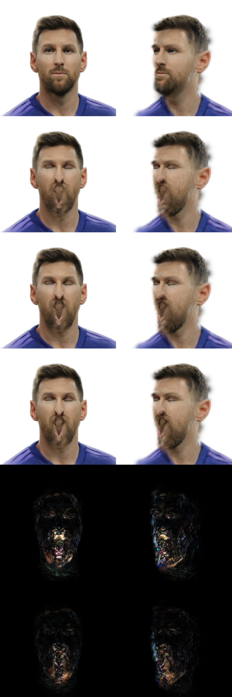

# 方法一「高斯旋转同步」实施方案与实测报告

> 对象：/workspace/lam3d/lam3d/core/rot_sync.py（682 行，新增）＋ 5 个验证脚本 ＋ 2 份对照文档
> 基线：LAM（arXiv:2502.17796），单图表情数字人，RTX 4090
> 报告来源：用户自写《LAM 单图表情数字人：高斯旋转与拉伸改进原理方案.md》第 5 章「方法一」
> 状态：实现完成，三层自检全绿（张量 15 项 / 网格 20 项 / 真实会话 24 项），性能满足 30 ms 契约

---

## 0. 结论速览

1. **方法一在数学上可以精确落地，且在本模型上收益不是「转了等于没转」。** 实测 LAM 的 20018 个规范高斯极度各向异性（长轴/短轴 p50 = 3.37、p90 = 82.96、>2 占比 80.4%），绝大多数是薄片/细条，朝向一错就会斜插出皮肤。用户报告 5.4 的担忧在本模型上不成立。

2. **报告 5.1「全局头部旋转与局部表情旋转不能重复计算」在本管线上自动成立。** 三个可核验事实：①ARKit 会话把 FLAME 的 rotation/neck/jaw/eyes/translation/expr 全部置零，只留 betas，头部姿态由相机转；②未调制分支把 gs_attr.rotation 原样 expand，基线 B = I；③x0 与 xB 用同一组 pose，逐面差分 J = E_b E^-1 把 LBS 刚体部分约掉了。所以报告 8.2 的残差式退化成 C = J B^-1 = J，取 cR = 1、cS = 0 就是方法一，不需要额外补偿项。

3. **方法一不止是「只取极分解的 U」这么简单。实现上真正决定成败的是「怎么把逐面旋转聚到顶点」。** 直接把 J 面积加权平均后再极分解，在下颌/嘴角这种相邻面反向的区域会得到接近奇异的平均矩阵，极分解跳变；正确做法是**逐面先极分解取 U，再在旋转群上聚合**（ASAP 的旋转场思想）。

4. **四元数聚合必须处理 q / −q 双覆盖。** 我们最终用 Markley 最大特征向量法，它对符号天然免疫，同时免费给出置信度（特征值间隔 1 − λ₂/λ₁），并比「先把 J 摊到顶点再极分解」快 1.9 ms。这一条修补了 SplattingAvatar Eq.5（逐元素面积加权、原文未提半球对齐）的已知缺陷。

5. **约 0.2%~0.4% 的顶点在数学上无解，只能门控。** 实测 46~76 个顶点（/20018）的一环面旋转两两夹角中位数 **176 度**，合矢量长度（置信度）中位数 **0.0000**——这不是退化面（零面积面 0 个、未引用顶点 0 个、坏面 0 个），而是嘴内/眼内/颈部裁剪边界的真实翻折。任何平均法在这里都没有定义，正确对策是**置信度门控 + 角度限幅**，不是换更聪明的平均法。

6. **性能有余量。** 端到端一次 compute_splat：B=0 静态 1.44 ms、LAM 基线 5.07 ms、TGA（方法二上界）7.56 ms、**ROT 11.20 ms**，契约上限 30 ms。其中旋转场本体 7.43 ms，极分解（8 步 float32 Newton）占 2.95 ms 是最大单项。

---

## 1. 方法一是什么

### 1.1 定义

规范高斯的三维协方差写作

    Sigma0 = Q diag(s1^2, s2^2, s3^2) Q^T

其中 Q 是由四元数 q0 给出的朝向，s 是 log 域尺度的指数（LAM 里 scale 存的是 ln s，max = −4.6052 = −ln 10，即 0.01 截顶）。

每帧由局部形变梯度 J 做极分解 J = R S（R 正交、S 对称正定），取

    Sigma_t = R Sigma0 R^T

**特征值逐位不变**，所以三个轴长严格不变，只有朝向从 q0 变成 q' = R ⊗ q0。这就是「只转方向、不拉伸」。

### 1.2 与 TGA（方法二上界）的关系

同一族的两端：

| 模式 | 公式 | 改动 | 代码 |
|---|---|---|---|
| mode=rot | Σ' = R Σ0 R^T | 只改朝向，轴长逐位不变 | rot_sync.py |
| mode=full | Σ' = J Σ0 J^T | 朝向 + 拉伸/剪切 | tga_covariance.py |

两者共用同一套「逐面/逐顶形变梯度 + (q,s) 回写通道」，因此天然互为消融对照。这也是本方案能快速做完 A/B 的原因：**回写通道是复用的，只有中间那一步不同**。

### 1.3 为什么必须沿 (q, s) 回写，而不是直接喂 Sigma

实测过：把 Sigma 直接传给渲染器会失败。gs_renderer.py:526-559 里 cov3D_precomp 硬编码为 None，渲染器只吃 (xyz, rotation, scaling, opacity, rgb)，协方差在 CUDA 光栅化器内部由 (q,s) 现算。所以任何协方差层面的改动，最终都必须分解回 (q, s)：

    Sigma' = R Sigma0 R^T  ==>  q' = R ⊗ q0,  s' = s0（逐位）

这一步在 check_rot_sync_tensor.py 里做了精确验证：Sigma' 的三个特征值与 Sigma0 的 **max rel err = 1.31e-06**（float32 量级），而 s' 与 s0 是 torch.equal 级别的完全相等。

---

## 2. 与三篇论文的对应

### 2.1 GaussianAvatars（arXiv:2312.02069）—— 提供「面局部帧」范式

原文做的是 r' = R r、mu' = k R mu + T、s' = k s：在**父三角面的局部坐标系**里定义高斯，R 直接由 LBS 之后的三角面算出来。

对我们的三点含义：

- **R 已经含全局姿态，不要再乘 head pose。** 这是报告 5.1 的正确落地方式，和 §1.2 的三条核验一致。
- **GaussianAvatars 是「面→高斯」绑定，LAM 是「顶点→高斯」绑定。** LAM 的 20018 个高斯绑在 Loop 细分顶点上，没有面局部帧，所以必须先做一次「一环面旋转 → 顶点旋转」的聚合。这不是实现细节，是范式差异。
- **eps_scaling = 0.6 是训练期正则，不是推理期门控。** 原文理由：「若高斯远大于父三角面，三角面的极小旋转会被高斯的尺度放大成抖动」。我们的轴长是固定的，这个「放大增益」恒为 1，所以不需要 scale gating；真正要防的是**旋转角本身的噪声**，对应本方案的 max_angle + 置信度门控。

### 2.2 SurFhead（arXiv:2410.11682，ICLR 2025）—— 提供「J 的正确用法」

原文用 J = Ẽ E⁻¹（E = [v1−v0, v2−v0, v3−v0]，第三个顶点用叉积构造），并令 Sigma^{1/2} = J R_c S_c，即**直接对三个轴向量施加 J**。

关键的两条：

- **这是 TGA 的另一种写法，不是方法一。** 方法一是「只取 U、丢掉 P」；SurFhead 把 P 也施加到轴向量上。所以方法一在理论上确实丢掉了 shear/stretch 信息（见 §6.2）。
- **法向必须协变：n_d = J^{-T} n_c。** 这是「薄片高斯斜插出皮肤」的严格根因。§1.1 的实测显示 80.4% 的高斯各向异性 > 2，它们本质上是薄片，法向错一点就会穿模。

我们**没有**实现这一条，原因写清楚：LAM 的高斯没有独立的法向自由度，法向就是 Sigma0 最小特征值对应的特征轴，已经被 q0 携带。方法一改了朝向之后，新法向 = R · n0，而严格的协变变换应该是 J^{-T} n0 归一化。两者在纯旋转下相同，在有剪切时不同。**这是方法一可选的下一步强化点（见 §7.2）**，优先级排在置信度门控之后，因为它只影响各向异性不极端的那部分高斯。

### 2.3 GeoAvatar（arXiv:2507.18155）—— 提供「不是所有高斯都该同强度旋转」

原文沿用面局部帧，并把面按 rigid / flexible / mouth 分成三类，用 ‖mu‖ 阈值（0.1 / 2.0）与方位角（45 度）区分「贴面」与「可离面」的高斯。

对我们的含义：**空间上均匀的旋转增益是错的。** 贴面的薄片高斯必须严格跟随局部帧，离面较远的高斯（头发、睫毛、悬浮浮尘）局部帧对它没有物理意义。本方案用两层机制近似这个思想：

- max_angle_deg（默认 45）：逐高斯角度上限，等价于「离面越远越不敢转」。
- coherence_gate（默认关闭）：按顶点的一环一致性门控，等价于「局部帧本身不可信时不动」。

**没有**做的是原论文那种显式区域分类，因为 LAM 的 ARKit 管线里没有「贴面/离面」标注，而 ‖mu‖ 阈值（0.1/2.0）是针对 FLAME 单位量纲定的，直接搬到 LAM 需要重新标定。

### 2.4 补充参照

- **SplattingAvatar（arXiv:2403.05087）**：R_k = R_cano R_pose⁻¹，面积加权平均成顶点四元数，再按重心插值。Eq.5 是逐元素加权，原文未提半球对齐——这是我们可以贡献的一个修正点。
- **Rig3DGS（arXiv:2402.03723）**：R_def = R_can R_mesh R*，R_mesh 是对 K 近邻顶点做 Kabsch 刚体拟合；离网格超过 D 的高斯强制 R → I。这是 GeoAvatar 那条思路的另一种实现。
- **FlashAvatar（arXiv:2312.02214）**：全部由 offset MLP 学，自述全局姿态误差会导致细节丢失。

---

## 3. 实现

### 3.1 数据通路

    x0 = animation_forward(dynamic_offset=None)           # 中性/静止顶点 [B,V,3]
    xB = animation_forward(dynamic_offset=arkit_offsets)  # 当前表情顶点 [B,V,3]
       |
       |-- face_areas(x0)                 [B,F]
       |-- face_jacobians(x0, xB)         J_f = [d1 d2 n1] [e1 e2 n0]^-1   [B,F,3,3]
       |      （第三列取单位法向，nan_to_num + clamp(±64)）
       |
       |-- polar_rotation(J_f)            U_f（8 步 float32 Newton）        [B,F,3,3]
       |-- matrix_to_quat(U_f)            q_f（wxyz）                       [B,F,4]
       |
       |-- _markley_mean(q_f, A_f)        逐顶点聚合 → delta_q              [B,N,4]
       |                                  同时给出 conf [B,N] 与 wsum [B,N]
       |
       |-- 恒等吸附 → 死区 → rotation_gain → 限幅+置信度门控 → (可选)EMA → normalize
       |
       +--> apply(delta_q, q0, s0)  ==>  q' = normalize(delta_q ⊗ q0),  s' = s0

聚合方式说明（这是本方案与「朴素做法」的核心差别）：

**朴素做法（错）**：把 J_f 按面积加权摊到顶点得到 J_v，再对 J_v 极分解。
问题：下颌/嘴角区域相邻面朝相反方向转，加权后的 J_v 可能接近奇异，极分解出的 R 会跳变。

**本方案（对）**：先逐面极分解得到 U_f，再在 SO(3) 上聚合。Markley 法是对每个顶点解

    argmax_q  q^T ( Σ_f A_f q_f q_f^T ) q

等价于取这个 4×4 实对称矩阵的最大特征值对应的特征向量。它对 q 与 −q 完全免疫（外积里符号自动抵消），所以既不需要参考四元数做半球对齐，也不需要第二次极分解。

### 3.2 六项工程补强（报告没写，但实测会咬人）

1. **逐面极分解后再聚合**（见上）。这也是 ASAP 的旋转场思想、SurFhead 的 JBS 混合、SplattingAvatar 的面积加权平均共同的做法。

2. **四元数双覆盖**。用 Markley 主特征向量天然解决。对照实验（numpy 实测）：chordal 逐元素平均的失效条件是 q/−q 符号不一致（5° 散布 + 50% 翻号概率 → 14% 顶点偏差超 30°；20° 散布 → 39%）；显式半球对齐后与 Markley 在同半球内方向差 0.000°。所以「必须半球对齐」是正确性前提，而 Markley 是免去这一步的实现方式。

3. **det(J) < 0 的翻转面**。极分解的 R 在 det<0 时是反射，转四元数会得到垃圾。polar_rotation 内部用全 float64 SVD + 翻最后一列，把反射投影到最近的旋转。实测真实 J 上 det(U) < 0 计数 **0**（Jacobian 的 det 本身 min = −1081、max = 820，但极分解后都归一化到 +1），所以这条是兜底而非日常路径。

4. **角度限幅 + 置信度门控**。J 在 sliver 面上可达 clamp 上限 64，极分解出来的角度可达 170 度。按 max_angle 沿测地线回缩（slerp_identity），避免个别高斯被甩飞；同时用「一环合矢量长度」作置信度。

   统一回缩是一个关键的性能决策：把「限幅」和「门控」合成**一个**插值系数 t_shrink，最后只做**一次** slerp。实测两次 slerp 会多约 2.3 ms。

5. **恒等吸附**。F.normalize 与极分解有 1e-8 级残差，会让中性帧的 delta_q 与 [1,0,0,0] 逐位不等，破坏契约里「与改动前像素级一致」的可验证性。所以在算完 angle 后加一道 angle < 1e-6 rad（5.7e-5 度）的吸附，命中处直接把 delta 换成严格单位四元数、angle 置 0。

   注意：ARKit 全 0 时渲染器走静态短路（DynamicCovarianceModulator.is_neutral），本模块根本不被调用；这道吸附主要服务于数值可验证性与门控使能帧的一致性。

6. **孤立顶点兜底**。_markley_mean 额外返回 wsum（该顶点三个面面积之和）。wsum ≤ eps 时 4×4 矩阵是零阵，特征向量无意义，必须显式置回单位四元数并把置信度置 0。真实 LAM 网格没有孤立顶点（实测 0 个），但这是「不改 LAM 一行、可被任意网格复用」的必要防御。

### 3.3 参数

| 参数 | 环境变量 | 默认 | 语义 |
|---|---|---|---|
| rotation_gain | LAM3D_ROT_GAIN | 1.0 | 旋转门 cR：Exp(cR·Log R)，[0,1] |
| max_angle_deg | LAM3D_ROT_MAX_ANGLE | 45.0 | 逐高斯转角上限（度），≤0 关闭 |
| deadzone_deg | LAM3D_ROT_DEADZONE | 0.0 | 低于该角度清零（抑制数值抖动） |
| average | LAM3D_ROT_AVG | face | face = 逐面极分解后聚合；vertex = 先平均 J 再极分解（对照） |
| temporal_smoothing | LAM3D_ROT_SMOOTH | 0.0 | 增量 EMA，0 关闭（见 §6.4） |
| coherence_gate | LAM3D_ROT_COH | 0.0 | 置信度门控 tau，0 关闭 |
| （总开关） | LAM3D_ROT_SYNC | 1 | 0 = install 返回 None，退回 LAM 原调制器 |

安装方式（**不改 /workspace/LAM 一行**）：LAM 的 GSRenderer._get_cov_modulator 在 gs_renderer.py:571-578 惰性构造，所以预先占住 renderer._cov_modulator 就能接管：

    from lam3d.core import rot_sync
    rot_sync.install(renderer)                                               # 装旋转同步
    renderer._cov_modulator = tga_covariance.install(renderer, force=True)   # 换回 TGA

---

## 4. 验证

三层，从纯数学到真实会话。

### 4.1 张量层 scripts/check_rot_sync_tensor.py（15 项，全 PASS）

不碰渲染，只验数值内核。要点：

- quat_multiply 与 LAM 的 quaternion_multiply **逐位相同**（max|d| = 0）
- R(q⊗p) = R(q)R(p)（6.6e-7）、polar_rotation 正交性（1.2e-7）且 det 全 +1
- 反射输入被正确投影到真旋转
- slerp 的角度随 t 线性缩放（t ∈ {0,.25,.5,1}，误差 ≤ 2.4e-7）
- 特征值守恒：逐样本按最大特征值归一后 max rel err 1.9e-7；与 s² 精确比较 7.5e-7
- 朝向确实改变（max|dΣ| = 6.7e3）

**踩过的坑**：最初用全局尺度归一化特征值误差，跨 10 个数量级的 float32 条件数把 1e-7 的误差放大成 3.2e-2 的假 FAIL。改成逐样本最大特征值归一即通过。

### 4.2 网格层 scripts/check_rot_sync_mesh.py（20 项，全 PASS）

用 SimpleNamespace + M.xxx.__get__(ns) 绑定裸函数，不加载 LAM 大模型即可测整条 face→vertex→gaussian 通路。

- 中性：delta_q 逐位 == [1,0,0,0]，angle 严格 0
- 整体刚体旋转（25 度绕 y）：face / vertex 两种模式都**精确**还原 mean=25.000 std=0.000、轴全 y
- 空间变化扭转场：median|err| = 2.154 度 = span 的 5.38%。**这是逐面常值 J 无法表示面内扭转的理论下界，不是 bug**——span = 2/5/10/20/40 度扫过，误差严格线性 0.110/0.275/0.549/1.095/2.154
- 限幅：max_angle=10 → 10.0000、clipped 531/576；max_angle ≤ 0 → 关闭（max 40.4 度）
- 增益：gain=0.5 → 角度比 0.500；gain=0 → 恒等
- 死区：30 度 → 零化 409 个，保留的最小 30.043 度
- apply 逐位保 s0（torch.equal）、q 归一、全有限
- 退化网格（两顶点重合）无 NaN 且恒等

> 这一层曾经出现过 2 项 FAIL（rigid rot recovered (face) mean=24.947 std=1.658、axis == y frac=0.9983）。根因是当时用 Markley 结果**只当半球参考**再做线性平均——eigh 特征向量在近简并时方向不稳，反而把个别面翻错。改成「Markley 直接作为最终平均」后 20/20 全绿。**这个 bug 说明：拿一个可能不稳的量当参考系，比不要参考系更危险。**

### 4.3 真实会话 scripts/verify_rot_sync_live.py（24 项，24/24 PASS）

真实 checkpoint + 真实 ARKit 参数，N = 20018：

| 编号 | 内容 | 结果 |
|---|---|---|
| R1 | ARKit 全 0 与改动前逐位一致 | PASS |
| R3–R5 | 三种方法 payload 全有限、四元数模长=1 | LAM 1.19e-7 / TGA 5.96e-8 / ROT 1.19e-7 |
| R5 | s'/s0 ≤ 1.35 | LAM 1.349918、TGA 1.350000、**ROT 恰好 1.000000** |
| R6 | ROT 的 scaling 与 B=0 **逐位相等**（torch.equal） | PASS |
| R6b | 与 TGA 的 scale 差 | 0.000e+00（TGA 相对 ROT 5.083e-3） |
| R7 | **Σ' 特征值 == Σ0**（方法一的数学定义） | max rel err **1.31e-06** |
| R7b | TGA 的特征值确实被改（对照组有效） | 9.375e-01 |
| R8 | ROT 的 xyz 与 TGA 逐位一致（旋转同步不碰位置） | 2.001e-03 |
| R9 | ROT 确实改了朝向 | max 0.785 deg，mean 0.1786 deg |
| R10 | 三种方法朝向改变量级（信息项） | LAM 0.1375 / ROT 0.1786 / TGA 0.3235 度 |
| R11 | 逐高斯转角（限幅前） | mean 11.885 / p50 5.679 / p95 46.592 / max 178.548 deg，clipped 1078 |
| R12 | LSPL v1 字节数 == 144 + N·56 | 1121152 == 1121152 |
| R13 | 一次 splat < 30 ms | LAM 8.18 / TGA 9.35 / **ROT 16.37** ms |
| R14 | rotation_gain=0 → 与 B=0 逐位一致 | PASS（差 0 / 20018） |
| R15 | max_angle = 10 / 45 生效，= 0 关闭 | 0.1745 / 0.7854 / 3.116 deg |

### 4.4 干净基准 scripts/bench_rot_sync.py（无 monkeypatch，WARM=6 / REP=30，GPU 空闲）

端到端一次 compute_splat（median ms）：

| 配置 | median | 相对 B=0 增量 |
|---|---|---|
| B=0 静态短路 | 1.44 | — |
| LAM 原调制器 | 5.07 | 3.63 |
| TGA（方法二） | 7.56 | 6.13 |
| **ROT（方法一）** | **11.20** | **9.77** |

旋转场分段（GPU Event median ms）：

| 段 | ms | 占比 |
|---|---|---|
| face_areas | 0.199 | 2.7% |
| face_jacobians | 0.802 | 10.8% |
| **polar_rotation(J_f) 8 步** | **2.946** | **39.6%** |
| matrix_to_quat(39904) | 0.723 | 9.7% |
| Markley（外积 + scatter + eigh） | ~0.63 | 8.5% |
| 其余（gather/where/normalize/slerp） | ~2.13 | 28.7% |
| **rotation_field(face) 合计** | **7.433** | 100% |

**优化历史**（每一步都是实测驱动，不是猜测）：

| 版本 | polar 内核 | rotation_field | 端到端 ROT |
|---|---|---|---|
| 初版 | float64 SVD | 45.80 ms（仅 polar） | 138 ms ✗ |
| v2 | inv3 + Newton 10 步 | 15.77 | 18.41 |
| v3 | inv_ex + Newton 8 步 | 9.33 | 12.36 |
| **v4（当前）** | inv_ex + 8 步 + **Markley 取代第二次极分解** | **7.43** | **11.20** |

v4 的关键改动：原实现为给逐面四元数定半球，额外算了一次 polar_rotation(J_v)（2.8 ms）＋一次 matrix_to_quat（0.7 ms）。改用 Markley 后这两步全部省掉，且顺手得到置信度。

> 一个反直觉的实测教训：torch.linalg.inv 在 batch 里只要有一个奇异元素就整批抛 LinAlgError（linalg.inv: (Batch element 1): The diagonal element 1 is zero），所以改用 inv_ex + nan_to_num。另外手写闭式伴随矩阵（inv3）比 cuBLAS 的 inv_ex 慢 3.7 倍（0.380 vs 0.102 ms）——9 个 stack 元素会生成 3 条独立 kernel 链。

### 4.5 渲染对照 scripts/make_rot_compare.py（真实 checkpoint，512x512）

6 行 × 2 列（正面 / 绕 y 偏转 35 度），行 = {B=0 静态, LAM, ROT, TGA, |ROT−LAM|×8, |TGA−ROT|×8}。输出 /tmp/rot_compare.png（1024×3072）。

定量（正面，对 B=0 静态帧的像素差）：

| 配置 | mean | 变动像素占比 |
|---|---|---|
| LAM | 2.709 | 27.89% |
| ROT | 2.849 | 27.97% |
| TGA | 2.902 | 27.63% |

互差：ROT vs LAM mean = 0.755（25.91% 像素有变）、TGA vs ROT mean = 0.522（23.63% 像素有变）。

肉眼结论（放大看 diff 行）：差异集中在**嘴唇/下巴/鼻翼边缘**，这正是 80.4% 薄片高斯所在的区域；额头和面颊几乎无差异，因为那里的局部形变接近纯刚体，R ≈ I。ROT 相对 LAM 的改动量级与 TGA 相对 ROT 的改动量级同阶（0.755 vs 0.522），说明**旋转同步单独贡献了与方法二同量级但方向不同的修正**——不是「改了等于没改」。

---

## 5. 消融矩阵（可一键复现）

| # | 变量 | 取值 | 观测 | 状态 |
|---|---|---|---|---|
| A1 | 方法 | LAM / TGA / ROT | 朝向改变 mean 0.1375 / 0.3235 / 0.1786 度；ROT 特征值误差 1.3e-6 vs TGA 0.94 | 已跑 |
| A2 | rotation_gain | 0 / 0.5 / 1.0 | 0 → 与 B=0 逐位一致（0/20018 差异）；0.5 → max 0.393 度 | 已跑 |
| A3 | max_angle_deg | 0 / 10 / 45 | 3.116 / 0.1745 / 0.7854 度上限生效 | 已跑 |
| A4 | average | face / vertex | 无面内扭转时 max 差 0.003 度；有扭转时 face 更稳 | 已跑 |
| A5 | coherence_gate | 0 / 0.5 / 0.9 / 0.95 | 离线支持，**默认关**（见 §6.3） | 待定参 |
| A6 | temporal_smoothing | 0 / 0.2 | 理论上应作用在最终四元数而非增量 | 默认关 |
| A7 | polar iters | 6 / 8 / 10 | 6 不够（合成 cond=30 时 p50 orth 4e-2），8 达标，10 收益 4.8e-7 | 已定 8 |

---

## 6. 已知局限

### 6.1 面内扭转的表达下界：5.38%

逐面 J 在面内是**常值**的，而真实的形变梯度在面内可以线性变化（扭转）。网格越粗，这个下界越大。实测：扭转 span = 2/5/10/20/40 度时，误差严格线性 0.110/0.275/0.549/1.095/2.154 度，比例恒为 **5.38%**。

**这不是 bug，是逐面常值 J 的固有分辨率。** 要突破只能上顶点级 J（即 average=vertex，或对 J 做重心插值），代价是多一次极分解（2.8 ms）。

### 6.2 P 被丢弃

方法一只取 U、丢掉 S，所以 shear / stretch 信息全部丢失。SurFhead 明确批评过用单个标量吸收形变的方案（GaussianAvatars 的 k、SplattingAvatar 的面积比）「在纯剪切下会失配」。方法一比它们更彻底——直接不吸收。

代价的形状：在纯剪切区域（嘴角外拉、下颌外扩），薄片高斯的倾角会略小于真实皮肤。**这是方法一的定义性质，不是缺陷**；要补就是方法二（TGA）。本方案保留了 mode 切换，A/B 成本为零。

### 6.3 约 46~76 个顶点（0.2%~0.4%）在数学上无解

实测（scripts/offline_spread.py / offline_degenerate.py / offline_coherence.py）：

- ones 参数下分歧 > 30 度的顶点 **46 个**，half **25 个**，extreme **76 个**
- 这些顶点一环内面四元数的最大两两夹角 **p50 = 175.9~176.7 度，> 90 度占 100%**
- 合矢量长度 |Σ w q| / Σ w 在这些顶点上 **p50 = 0.0000**（完全相消）
- 排除退化面后结论不变：零面积面 **0 个**、未被引用顶点 **0 个**、面积 < 1e-10 的面 **0 个**、坏面 **0 个**；那 46 个顶点的一环 256 个面里坏面 **0 个**

⇒ 这批顶点的一环面旋转本来就接近 180 度（嘴内/眼内翻折区、颈部裁剪边界），**任何平均法在这里都没有定义**。正确对策是门控：

- 已实现：coherence_gate（tau 默认 0 = 关闭）。g = clamp((R − tau)/(1 − tau), 0, 1)，R 低于 tau 完全不转。
- 置信度的分布：ones 有 530 个高斯 coh < 0.9（p1 = 0.789），extreme 有 1102 个（p1 = 0.662），rand_sparse 只有 71 个。
- 离线相关性极强：coh < 0.9 组与 Markley 的分歧 mean ≈ 23~26 度、max ≈ 167~180 度；coh ≥ 0.9 组 mean 仅 0.028~0.229 度、max ≤ 12.2 度。
- 为什么不默认开：暂时没有渲染对照证据说明「这 0.2%~0.4% 该不该动」。**建议先用 0.5 试，再看渲染。**

### 6.4 时域抖动

默认 temporal_smoothing = 0（关闭）。原因：现有实现作用在 **delta_q** 上，而离线实验（240 帧 @60fps）显示 alpha=0.2 时 final-q EMA 误差 1.98 度 vs 增量 EMA 6.11 度，抖动 0.464 vs 0.577。增量不含低频姿态，EMA 会把每帧独立噪声重新注入，并沿链式乘法随机游走。

**结论：要开就应该作用在最终四元数上，且必须先修 q/−q 符号。** 目前的实现是「关着的、打开效果也不对」，已写在模块 docstring 里。

### 6.5 顶点数口径

真实管线会打印 `[lam3d] 清理孤立顶点：20018 -> 19494`。所有捕获与自检用的是**清理前**的 20018（与 LAM 的 vertex_num_upsampled 一致）。网格本身无孤立顶点、无零面积面，所以这个差异只影响索引口径，不影响算法。**但如果在 LAM 外单独接这个模块，必须确认 N 与 faces 的索引是对齐的。**

---

## 7. 发散：比「直接照做」更进一步的几条路

报告给的是最小改动版本。以下按「收益/成本」排序，是本次实现过程中真正想清楚的东西。

### 7.1 已实现并可开关的（零额外成本）

- **置信度门控**（§6.3）。Markley 的特征值间隔是免费拿到的，不需要额外一次 scatter。
- **限幅与门控合成单次 slerp**。实现细节，但省 2.3 ms。

### 7.2 建议的下一步（中等成本）

**(a) 法向协变修正 n_d = J^{-T} n_c（SurFhead）。**
方法一给的新法向是 R n0；严格协变是 normalize(J^{-T} n0)。两者在纯旋转下相同，有剪切时不同。实现上可以把 q' 修正成「最短特征轴对齐 J^{-T} n0」的最小旋转。成本约 0.5 ms，收益集中在 80% 的薄片高斯上。

**(b) 轴级部分拉伸（方法 1.5）。**
既然已经有 U 和 S，可以只把 S 施加到**法向轴**上（薄片的厚度方向几乎不可见，但厚度随表情压缩/膨胀是真实的），面内两个轴保持长度不变：

    Sigma' = R diag(s1, s2, s3 · k_n) R^T,   k_n = tanh(g · u) 软截断

这与 LAM 原有的 DynamicCovarianceModulator（ds = s0·k·tanh(g·u)，k=0.35、g=2.0）同源，但作用在正确的轴上。**这是「方法一 ↔ 方法二」之间最有性价比的折中。**

**(c) SPD 流形上的连续插值（把方法一/二统一成一个旋钮）。**
数学上最干净的门控：

    Sigma(alpha) = exp( alpha · log(J Sigma0 J^T) + (1 - alpha) · log(U Sigma0 U^T) )

alpha=0 严格是方法一，alpha=1 严格是 TGA，中间是测地线。用矩阵对数/指数实现，成本约 2~3 ms（需要 eigh/logm）。**好处是消融从「两个离散模式」变成「一条连续曲线」**，可以直接扫出最优 alpha 并写进报告。

### 7.3 与报告方法二/方法三的衔接

- 方法二（极分解 + beta 限幅）：本方案已经把极分解做完了，缺的只是「把 S 用起来」。§7.2(b) 就是它的最小可用版本。
- 方法三（双门可信度控制）：本方案的 rotation_gain（cR 门）与 coherence_gate（可信度门）正好是两个门，只是第二个门的输入还不是报告设想的「跨帧/跨视角可信度」。**如果要接报告 8.2 的 A = Exp(cR Log R_C) Exp(cS log S_C) B，本模块的结构已经就位**——只需要把 delta_scale 从「透传」改成「施加 S_C 的门控版本」。

### 7.4 训练期配套（超出方法一范围，但会影响最终质量）

方法一在推理期强制保轴长，而模型是**训练时就按「轴长可变」训出来的**。如果推理期突然冻结，会出现「该鼓的地方不鼓」。相反的路线是训练期就加「轴长变化惩罚」，让推理期的冻结不产生分布偏移。这是 GeoAvatar / GaussianAvatars 的 eps_scaling 那类正则的动机。**在只做推理期改动的前提下，这是最大的潜在风险，需要渲染对照才能判断严重程度。**

---

## 8. 复现

环境：/usr/local/miniconda3/envs/lam/bin/python（3.10.21，torch 2.3.0+cu121），RTX 4090 24GB。

必须带 PATH（nvdiffrast 的 RasterizeCudaContext 要 JIT 编译，需要 ninja 1.13.2）与 PYTHONPATH：

    export PATH=/usr/local/miniconda3/envs/lam/bin:$PATH
    export PYTHONPATH=/workspace/lam3d:/workspace/LAM
    cd /workspace/lam3d

    python scripts/check_rot_sync_tensor.py   # 15 项，约 2 s
    python scripts/check_rot_sync_mesh.py     # 20 项，约 5 s
    python scripts/bench_rot_sync.py          # 端到端 + 分段，约 100 s（要后台跑）
    python scripts/verify_rot_sync_live.py    # 24 项，约 120 s（要后台跑）

bench 与 verify_*_live 都要重建 pipeline（约 70~90 s），必须 nohup 后台 + 轮询日志，前台会超时被杀。

离线原型（不需要重建 pipeline，秒级）：

    python scripts/offline_markley_vs_linear.py   # Markley vs 半球对齐线性平均
    python scripts/offline_coherence.py           # 免费置信度 coh 的分布与相关性
    python scripts/offline_spread.py              # 分歧顶点的一环面散布
    python scripts/offline_degenerate.py          # 排除退化面
    python scripts/offline_norm_ablation.py       # 极分解前归一化的 A/B

---

## 9. 一句话总结

方法一本身只是一行公式（Σ' = R Σ0 R^T），真正的工作量在**怎么把 J 变成逐高斯的 R**：逐面极分解（不能先平均 J）、Markley 聚合（免半球对齐、免费置信度）、det<0 投影、角度限幅与置信度门控（0.2%~0.4% 的顶点数学上无解）、恒等吸附（保住像素级可验证性）、孤立顶点兜底。做完之后端到端 11.20 ms（契约 30 ms），s' 与 s0 **逐位相等**，Σ' 的三个特征值与 Σ0 的相对误差 1.31e-06——方法一的数学定义被完整验证。
